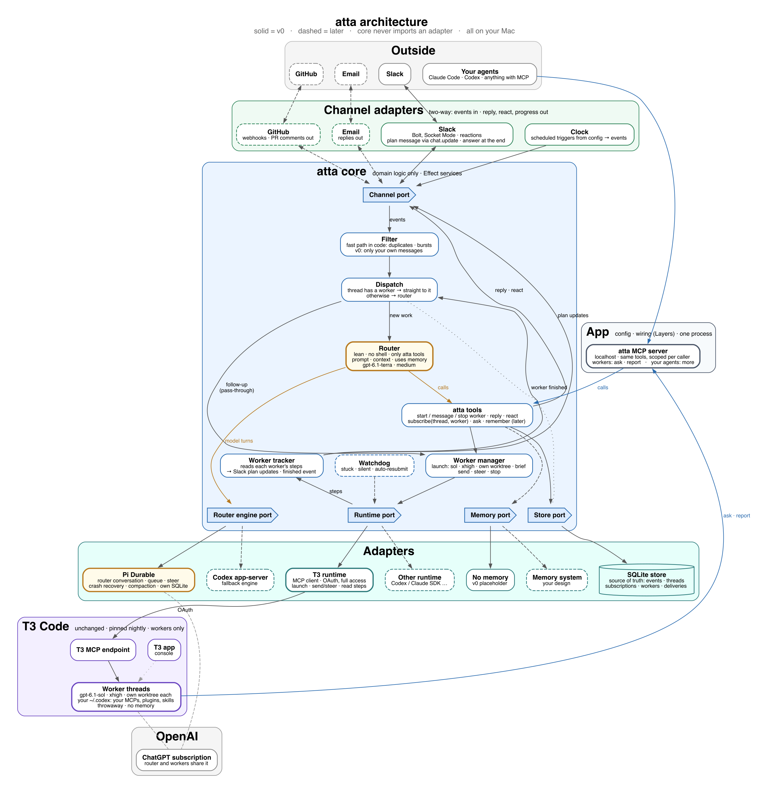

# atta

Send work to coding agents from Slack and follow it there.

You write to atta in Slack. A lean router decides what to do: answer you, ask a question, or start a worker. Workers are coding agents running in [T3 Code](https://github.com/pingdotgg/t3code) on your own subscription. You watch their steps in the Slack thread, reply to steer them, and get the result in the same thread.

atta is named after leafcutter ants, whose colonies split the work between castes.

Status: v0 is being finished: every part is built and tested against fakes, and the end-to-end checks against real Slack and T3 are next. See [the v0 plan](docs/v0-plan.md).

## How it fits together



- Channels (Slack now, GitHub and email later) turn messages into events.
- The router runs on [Pi Durable](https://github.com/earendil-works/pi) with no shell, only atta's tools.
- Workers run in T3 Code with your own Codex setup, and call back through atta's MCP server.
- Everything is stored in SQLite on your machine.

## Running atta on your Mac

You need Node 24, pnpm 12, the Codex CLI signed in to your ChatGPT account, and a Slack workspace where you can add apps.

1. Install: `pnpm install`.
2. Create the Slack app from [slack/manifest.json](slack/manifest.json) (api.slack.com, Create an app, From a manifest). Install it, then put its bot token and app-level token in `~/.atta/env` (copy [.env.example](.env.example), mode 0600).
3. Copy [atta.config.example.ts](atta.config.example.ts) to `~/.atta/atta.config.ts` and fill in your Slack member ID, repositories and schedules.
4. Prepare T3 Code's data folder: `sh scripts/setup-t3.sh`. It adds a worker instance that uses your own Codex setup and atta's MCP server.
5. Start the services: `sh scripts/install-services.sh`. It installs and starts T3 Code and atta with launchd. Logs are in `~/.atta/logs`.
6. Open T3 Code once (`http://127.0.0.1:3999`), add your repositories as projects, and put their project IDs in the config.
7. Sign in, once each: `ATTA_CONFIG=~/.atta/atta.config.ts node --experimental-strip-types src/app/main.ts login t3` (approve with full access), then `... login router` (Sign in with ChatGPT).

Then DM atta in Slack.

## Development

You need Node 24 and pnpm 12.

```bash
pnpm install
pnpm sync:repos   # read-only Effect and Pi sources for reference, in .repos/
pnpm check        # format, lint, types, tests, unused code
```

Contributor and agent guidelines are in [AGENTS.md](AGENTS.md).

## License

[MIT](LICENSE)
