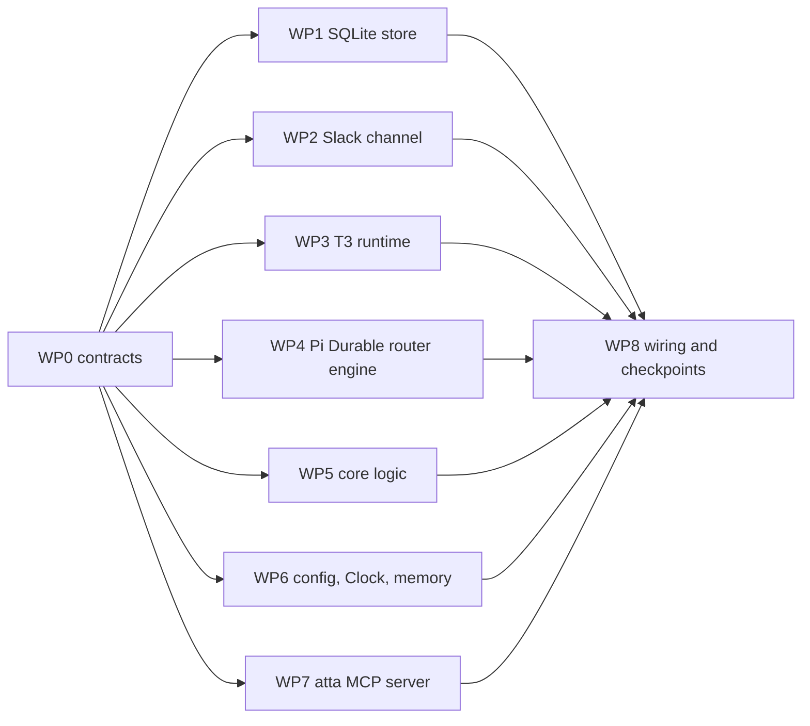

# atta v0 plan

atta is named after leafcutter ants, whose colonies split the work between castes.

atta v0 lets you send work to agents from Slack and follow it there. You write to atta in Slack. A lean router decides what to do. Throwaway workers do the work in T3 Code, and you see their progress in the Slack thread until they report back.

This plan says what v0 includes, how it is built, in what order, and how we will know it works. Nothing here is built yet. Building starts when you say so.

- Architecture diagram: [docs/architecture.png](architecture.png) (source in `architecture.dot`)
- Worker lifecycle statechart: [docs/worker-lifecycle.png](worker-lifecycle.png) (source in `worker-lifecycle.dot`)
- Evidence: [T3 as the runtime](proofs/t3-runtime.md), [Slack progress](proofs/slack-progress.md), [router on Pi Durable](proofs/router-pi-durable.md)

## What v0 does

When v0 is done, you can:

1. DM atta or mention it in a channel, and get a reaction within a second.
2. Ask a question, and get an answer in the thread from the router.
3. Ask for code work on an allowed repository. The router proposes a worker, you approve it with one click, and it runs in its own worktree.
4. Watch the worker in the thread as a Slack plan message. Each command, file edit or step is a task.
5. Get the result in the same thread when the worker finishes.
6. Reply in the thread while the worker runs, in a DM or by mentioning atta in a channel. Your reply goes straight to that worker without the router.
7. Say "stop" in the thread, and the worker stops.
8. Have scheduled prompts from the config file run as if you had sent them.
9. Restart your Mac or atta, and find running work still tracked and reported.

## What v0 leaves out

These are deliberately out of scope. Each one plugs into an interface v0 already has:

- the memory system (v0 uses a placeholder that remembers nothing)
- GitHub and email channels
- messages from anyone except you
- automatic resubmission of interrupted runs, and detection of stuck runs (the watchdog)
- Claude as router or worker
- running anywhere except your Mac

## Decisions already made

| Area                   | Decision                                                                                                       | Evidence                                                                            |
| ---------------------- | -------------------------------------------------------------------------------------------------------------- | ----------------------------------------------------------------------------------- |
| Interface              | Slack, through a Slack app in Socket Mode, so no public webhook                                                | Slack proof                                                                         |
| Progress               | One `plan` message per worker run, edited with `chat.update` at most once a second, then the answer at the end | Slack proof: streams close after 10.1 minutes and turn unfinished tasks into errors |
| Router                 | atta runs it, on Pi Durable, with `gpt-6.1-terra` at medium, no shell, and only atta's tools                   | Router proof                                                                        |
| Workers                | T3 Code, unchanged, pinned nightly. `gpt-6.1-sol` at xhigh, one worktree each. They use your own `~/.codex`    | First proof                                                                         |
| Talking to T3          | T3's MCP endpoint, signed in with full access                                                                  | First proof                                                                         |
| Worker callbacks       | atta's MCP server on localhost, added through T3's worker launch settings                                      | Router proof                                                                        |
| Models                 | One ChatGPT subscription for the router and the workers                                                        | Router proof                                                                        |
| Where it runs          | Your Mac, as background services                                                                               | Your decision                                                                       |
| Language and libraries | TypeScript, Effect 4, SQLite                                                                                   | Your decision                                                                       |

## How it is built

The [architecture diagram](architecture.png) shows the parts. In short:

- Channel adapters turn Slack messages and scheduled prompts into events, and send replies, reactions and plan updates back.
- Core holds the logic: filter, dispatch, router, atta's tools, worker manager and worker tracker. Core never imports an adapter.
- Ports connect core to the outside: Channel (Slack), ScheduledPrompts, RouterEngine with RouterTools, Runtime (T3), Memory, Store and WorkerApi.
- Adapters implement them: Slack and Clock, Pi Durable, T3, a placeholder memory, and SQLite.
- One app process wires it all together and runs atta's MCP server.

### Code layout

One package, not a monorepo. Folders keep the layers apart, and a lint rule stops core from importing adapters.

```text
atta/
  src/
    core/            domain types, filter, dispatch, router, tools, worker manager, worker tracker
    ports/           Channel, RouterEngine, Runtime, Memory, Store (Effect services)
    adapters/
      slack/         Bolt in Socket Mode, plan messages, reactions
      clock/         scheduled prompts from config
      pi-durable/    router engine
      t3/            runtime (MCP client)
      memory-none/
      sqlite/        store and migrations
    mcp/             atta MCP server
    app/             config, wiring (Layers), main
  test/
  launchd/           service definitions
  atta.config.ts
```

### Interfaces

Each interface is an Effect service. WP0 writes them as code; the lists below say what each must carry.

- Channel:
  - `events: Stream<InboundEvent>`. Every event says where it came from (see routing below)
  - `reply(thread, text, operationId)`. Tags the Slack message with the operation ID, so recovery can find it
  - `react(message, emoji)` and `unreact(message, emoji)`
  - `upsertPlan(thread, planId, title, tasks)`
  - `finishPlan(thread, planId, outcome, answer)`, where outcome is completed, failed, interrupted or stopped
- RouterEngine:
  - `submit({ requestId, content, whenBusy })`
  - `settled(requestId)`
  - it runs the router tools defined in core, through a tool contract WP0 defines: name, description, input schema, whether it is safe to repeat, and a handler that is an Effect
- Runtime:
  - `launch({ repo, title, brief, operationId })` returns the worker reference, the run ID, the branch and the worktree path. T3 ignores a repeated `operationId` (its `clientRequestId`), so a launch is safe to repeat
  - `send(worker, text, "steer" | "queue")` returns the run ID it went to
  - `stop(worker)`
  - `steps(worker, afterPosition)` returns steps and the next position. On the last page T3 returns no next position, so the caller keeps its own
  - `status(worker)` returns the run state, the run ID, the current branch and the latest commit
- ScheduledPrompts: `events: Stream<ScheduledPrompt>`, each slot once, also across restarts (the Clock adapter)
- RouterTools: the instructions and tools the router runs with. Core provides it; the engine adapter reads it
- Memory:
  - `recall(query)`
  - `remember(fact)`, which does nothing in v0
- Store: one repository per table, and `transaction(effect)` so a group of writes lands together or not at all.
- WorkerApi (used by atta's MCP server): `ask(workerId, question)`, `report(workerId, text)` and `say(workerId, text)`. Core implements it; WP7 exposes it.

### Stored data

atta's SQLite file is the source of truth. Pi Durable keeps only the router's conversation, in its own SQLite file.

| Table                | Holds                                                                                                                                                                                                                                         | Notes                                                                              |
| -------------------- | --------------------------------------------------------------------------------------------------------------------------------------------------------------------------------------------------------------------------------------------- | ---------------------------------------------------------------------------------- |
| `events`             | every event: Slack message, scheduled prompt, worker report, worker finished. Worker steps are not stored: T3 keeps them. The tracker saves its read position, and after a restart rereads the run from the start to rebuild the plan message | append-only. Unique on source and external ID, so a Slack retry is stored once     |
| `threads`            | one row per conversation thread, keyed like `slack:T01/D01/1700000000.000100`                                                                                                                                                                 | channel, title, last activity                                                      |
| `workers`            | one row per worker: T3 thread ID, repo, brief, state, last read position, plan message reference                                                                                                                                              | state follows the statechart                                                       |
| `worker_transitions` | every state change, with reason and time                                                                                                                                                                                                      | append-only                                                                        |
| `subscriptions`      | which worker listens to which thread                                                                                                                                                                                                          | many-to-many, as in the article                                                    |
| `deliveries`         | where each event went (router or a worker) and whether it arrived                                                                                                                                                                             | gives at-least-once delivery after a crash                                         |
| `outbox`             | every action atta takes outside: Slack posts and reactions, worker launches, steers and stops                                                                                                                                                 | each has a stable operation ID, a status and the result (Slack message, T3 thread) |

### Flow of one message

1. The Slack adapter receives your message and stores it as an event. It ignores duplicates by Slack event ID.
2. The filter applies to Slack messages only. A request is your DM or your mention of atta; everything else is dropped and logged, except in watched channels, where it is batched as information (see [watched channels](watched-channels.md)). Events atta creates itself (scheduled prompts, worker reports, worker finished) are trusted by kind.
3. Core adds a 👀 reaction straight away, without waiting for a model.
4. Dispatch routes by event kind:
   - your message saying only "stop" stops the thread's workers, without the router, with or without a mention
   - your other requests go to the thread's subscribed worker: as a steer while it runs, as a new run while it is idle. With no worker, or more than one, they go to the router
   - scheduled prompts, worker reports and "worker finished" always go to the router
5. The router gets the event as one input. It answers with tools:
   - `reply` posts in the thread and ends the router's run, which saves the closing model turn the proof showed
   - `start_worker` proposes a worker: you get a DM with its title, reason and whole brief, and Start and Skip buttons
6. On Start, the worker manager launches the worker through the T3 adapter, and posts the plan message in the thread. The router hears the decision as an event.
7. The worker tracker reads the worker's steps from T3 by position. It updates the plan message at most once a second.
8. When the run ends, the tracker stores a "worker finished" event with the worker's final message. Dispatch sends it to the router.
9. The router replies in the thread with the result.

👀 means atta has your message. It becomes ✅ when atta has handled it: the router answered, or a worker took it. The plan message, not the reaction, shows the work going on. Events reach the router as queued inputs, one after another; v0 does not steer the router mid-turn.

Each step writes its state change, its new events and its outbox entries in one transaction. The outside action (a Slack post, a T3 launch) happens after the commit. Its result is recorded in the same transaction that marks the outbox entry done: a worker's new run, for example, lands together with its state change. Every operation on one worker holds that worker's lock and rereads its state, so a message, a stop and the tracker never act on a stale worker.

### Recovery after a crash

At startup, atta finishes what a crash cut short:

- outbox entries still pending are retried. A T3 launch is safe to repeat because T3 ignores a repeated request ID. Before reposting to Slack, atta looks for a message tagged with the same operation ID in the thread and reuses it
- deliveries not marked done are delivered again. The router ignores a repeated request ID
- each worker that is running or launching is checked with `status`. The tracker rebuilds its plan message by reading the current run's steps from the start (T3 keeps them), then goes on reading from the end
- Pi Durable resumes the router's own unfinished turn, as the router proof showed
- known gap: an event the router was still answering when atta died keeps its 👀; the answer itself still arrives
- known gap: if a worker's run ends in the instant between atta checking it and a steer arriving, and T3 turns the steer into a new run, atta keeps following the old run and logs a warning

### The router

The router is a long-lived Pi Durable conversation, with automatic compaction. Events arrive as inputs, and new events queue while it works. Watched-channel messages arrive in batches, each batch its own input.

The router knows the configured repositories, with each one's AGENTS.md, read when atta starts. It reads them to know what a repository is and to write good briefs; their rules are for the workers, who read them from their own worktrees, which also hold the repository's skills.

The router only reads and decides, but two tools reach a worker's shell: the brief of `start_worker`, and `message_worker`. So every worker start needs your click, and in a turn a channel batch started, every acting tool except `start_worker` refuses. Each tool call carries the newest input the model had read, which tells core what started the turn.

Its tools are written once in core as Effect programs. The Pi Durable adapter wraps each one in a Pi tool that runs the program:

| Tool                                 | Does                                    | Safe to repeat after a crash                                                                   |
| ------------------------------------ | --------------------------------------- | ---------------------------------------------------------------------------------------------- |
| `reply(thread, text)`                | posts in the thread and ends the run    | yes: the store records each reply before posting it, and a replay skips a reply already posted |
| `start_worker(repo, title, brief)`   | proposes a worker for your approval     | yes: the proposal's ID comes from the call ID, so a replay sends one request                   |
| `message_worker(worker, text, mode)` | steers or queues a message for a worker | no                                                                                             |
| `stop_worker(worker)`                | stops a worker                          | yes                                                                                            |
| `subscribe(thread, worker)`          | links another thread to a worker        | yes                                                                                            |
| `read_conversation(from, limit)`     | reads a thread or a channel's latest    | yes                                                                                            |
| `recall(query)`                      | asks memory and state for context       | yes                                                                                            |

The prompt states the rules the proof showed we need:

- briefs must be self-contained and must never name a branch to commit to
- every event that needs your attention gets a `reply`

### Workers

Workers run in T3 with your own Codex setup, including your MCP servers, plugins and skills. atta adds only two things through T3's launch settings for the worker instance:

- the reasoning effort (xhigh)
- atta's MCP server (`mcp_servers.atta.url`)

Each brief ends with a fixed footer:

- your worker ID
- use `atta.ask` when you need context
- call `atta.report` when you are blocked and need a decision (atta sees by itself when you finish)
- your messages start with "The user wrote in your Slack thread:"; answer each one briefly with `atta.say`, then carry on
- work on the branch T3 created for you, and do not switch branches

When a worker finishes, the tracker checks which branch it committed to. If it is not the worker's own branch, the tracker flags it in the thread.

### atta's MCP server

It listens on `127.0.0.1` only. Workers can call three tools:

- `ask(worker_id, question)` is answered from state and, later, memory. It is read-only
- `report(worker_id, text)` becomes an event for the router
- `say(worker_id, text)` posts a short message (up to 3,000 characters) in the worker's own thread. It is how a worker answers you while it works, so you can steer it. It cannot post anywhere else

v0 trusts the worker ID that the brief gives each worker. Real per-caller authentication comes when other agents use the server.

### Configuration

`atta.config.ts` is typed and checked at startup with Effect Schema. It holds your own Slack and repository details, so git ignores it. The repository has `atta.config.example.ts` instead. It holds:

- Slack app tokens, read from the macOS Keychain or a `.env` file that git ignores
- your Slack user ID, as the only trusted sender
- allowed repositories: name, local path and T3 project ID
- models and reasoning levels for the router and workers
- scheduled prompts: cron expression, thread, text
- how long an idle worker stays subscribed (default 7 days)

### Running on your Mac

Two launchd services start at login and restart if they exit:

- `com.atta.t3` runs `t3 serve` on `127.0.0.1:3999`, with its data in `~/.atta/t3`
- `com.atta.app` runs atta, with logs in `~/.atta/logs`. A named instance, `com.atta.app.<name>`, runs a second atta from `~/.atta-<name>`, for another Slack workspace

When the Mac sleeps, Slack disconnects and workers pause. Both recover when it wakes: Slack reconnects, and the tracker reads from its last stored position.

### Stack

All versions are pinned exactly.

| Package                                                                        | Version                       | Why                                                                    |
| ------------------------------------------------------------------------------ | ----------------------------- | ---------------------------------------------------------------------- |
| Node                                                                           | 24 LTS (24.13.1 now)          | what T3 and the proofs ran on                                          |
| `effect`, `@effect/platform-node`, `@effect/sql-sqlite-node`, `@effect/vitest` | 4.0.7                         | the 4.0 line T3 uses, which keeps the Codex fallback client compatible |
| `@earendil-works/pi-durable`, `pi-ai`, `chord`, `pi-schema`                    | 1.5.0                         | tested in the router proof. The API changes between releases           |
| `@slack/bolt`                                                                  | 5.1.0                         | tested in the Slack proof                                              |
| `@slack/web-api`                                                               | 8.3.0                         | tested in the Slack proof                                              |
| `@modelcontextprotocol/sdk`                                                    | 1.32.2                        | T3 client and atta's MCP server, both tested                           |
| `vitest`                                                                       | 5.1.0                         | needed by `@effect/vitest` 4.0.7                                       |
| T3 Code                                                                        | `0.1.7-nightly.20261102.4066` | tested in the first proof. Upgrade on purpose, never automatically     |
| pnpm                                                                           | 12.x (12.5.1 installed)       | package manager                                                        |

## Order of work

The work runs in three waves. Wave 1 fixes the contracts everyone codes against. Wave 2 builds the parts in parallel, each against those contracts and fakes. Wave 3 wires the parts together and runs the Slack checkpoints.



### Who builds what

Claude (this session) builds the parts that set the design: the contracts, the core logic and the wiring. Codex (`gpt-6.1-sol` at xhigh, through the CLI) builds the adapters in parallel, each in its own worktree. See the [codex-worker skill](../.agents/skills/codex-worker/SKILL.md).

Every package gets a review from the other side before it lands:

- Claude reviews each Codex package
- Codex reviews WP0, WP5 and WP8

At most three Codex workers run at once. That keeps the shared usage limit and the reviews manageable.

### Work packages

| ID  | Package                                                                                                                                                                                                                                                                                                                                                                                                                                                            | Builder | Owns                                                                                                           | Done when                                                                                                                                        |
| --- | ------------------------------------------------------------------------------------------------------------------------------------------------------------------------------------------------------------------------------------------------------------------------------------------------------------------------------------------------------------------------------------------------------------------------------------------------------------------ | ------- | -------------------------------------------------------------------------------------------------------------- | ------------------------------------------------------------------------------------------------------------------------------------------------ |
| WP0 | Contracts: domain types and schemas (event with its origin, thread key, worker, brief, step, operation ID), the ports and WorkerApi as Effect services, the router tool contract, event routing rules, the worker statechart as a pure transition function, the config schema with `atta.config.example.ts`, a fake for every port, knip entry points for each package, and published test fixtures (recorded T3 responses, sanitized, and the Slack app manifest) | Claude  | `src/ports`, `src/core/domain`, `test/fakes`, `test/fixtures`, `slack/manifest.json`, `atta.config.example.ts` | types compile. The statechart test covers every arrow in the [statechart](worker-lifecycle.png). Codex has reviewed it                           |
| WP1 | SQLite store: migrations for the 7 tables, one repository per table, `transaction`, duplicate-event protection                                                                                                                                                                                                                                                                                                                                                     | Codex   | `src/adapters/sqlite`                                                                                          | tests on a temporary database cover duplicate events, transitions, deliveries, outbox entries and a transaction that fails halfway               |
| WP2 | Slack channel: Bolt in Socket Mode to `InboundEvent` for DMs and mentions, `reply` tagged with its operation ID, finding a tagged reply again, `react` and `unreact`, plan messages with `chat.update` at most once a second, grouping above 50 tasks                                                                                                                                                                                                              | Codex   | `src/adapters/slack`                                                                                           | tests with a fake Slack client cover deduplication, DMs and channel mentions, throttling, grouping, thread keys and finding a tagged reply       |
| WP3 | T3 runtime: MCP client with OAuth tokens, `launch` with a request ID, `send`, `stop`, `steps` by position, `status` with branch and commit                                                                                                                                                                                                                                                                                                                         | Codex   | `src/adapters/t3`                                                                                              | tests against the recorded T3 responses in `test/fixtures/t3` cover each call, a repeated launch, the last-page position and "interrupted" runs  |
| WP4 | Router engine: Pi Durable harness that runs core's router tools through the WP0 tool contract, `submit`, `settled`, `reply` ending the run, and the ChatGPT sign-in program behind `atta login`                                                                                                                                                                                                                                                                    | Codex   | `src/adapters/pi-durable`                                                                                      | tests with Pi's in-memory storage and Pi's `faux` model provider, using fake tools, cover tool calls, steering, duplicate request IDs and resume |
| WP5 | Core logic: filter, dispatch by event kind, the outbox and recovery at startup, worker manager, worker tracker (steps to plan tasks, finish detection, branch check), the router's tools and prompt, and WorkerApi                                                                                                                                                                                                                                                 | Claude  | `src/core` (except `domain`)                                                                                   | tests with the WP0 fakes cover flow steps 1 to 9, recovery, and scenarios 1, 2, 5, 6 and 11                                                      |
| WP6 | Config loading, the Clock channel (cron prompts to events) and the placeholder memory                                                                                                                                                                                                                                                                                                                                                                              | Codex   | `src/app/config.ts`, `src/adapters/clock`, `src/adapters/memory-none`                                          | tests with Effect's test clock show each prompt fires once per slot, also after a restart                                                        |
| WP7 | atta's MCP server: exposes WorkerApi's `ask` and `report` over HTTP on `127.0.0.1`                                                                                                                                                                                                                                                                                                                                                                                 | Codex   | `src/mcp`                                                                                                      | tests call both tools with the MCP client against a fake WorkerApi                                                                               |
| WP8 | Wiring and checkpoints: layers in `src/app`, `main.ts` with its commands (`start`, `login`), launchd services, logs, an end-to-end runner that CI never runs (`pnpm e2e`), moving T3's data to `~/.atta/t3`, then the end-to-end scenarios below                                                                                                                                                                                                                   | Claude  | `src/app` (except `config.ts`), `launchd`, `test/e2e`                                                          | all 12 scenarios pass on your Mac                                                                                                                |

### Rules that keep parallel work safe

- WP0 lands before any wave 2 package starts. Changing a port after that needs a pull request of its own, and every open package rebases onto it.
- A package changes only the files it owns. Everything not owned by a package belongs to the coordinator (Claude) and changes only in WP0 and WP8: `package.json`, `pnpm-lock.yaml`, `pnpm-workspace.yaml`, `tsconfig.json`, `vitest.config.ts`, `knip.json`, lint and format config, CI, `scripts/`, `docs/`. A package that needs a new dependency or a config change asks first.
- Before a package lands, the coordinator checks that every changed path, tracked or new, is one the package owns.
- Every dependency the plan needs is already installed and pinned, so wave 2 needs no lockfile changes.
- Each package lands as one pull request with CI green.

### Slack checkpoints

The milestones become checkpoints in WP8. Each one is something you can try in Slack.

| #   | Checkpoint               | Needs                                                                                          | You can try                                                           |
| --- | ------------------------ | ---------------------------------------------------------------------------------------------- | --------------------------------------------------------------------- |
| 1   | Events in, reactions out | WP1, WP2, WP5 (filter, dispatch), WP6                                                          | DM atta and get 👀. The event is stored once, even when Slack retries |
| 2   | Router answers           | WP4, WP5 (router tools)                                                                        | ask a question and get an answer in the thread                        |
| 3   | Workers                  | WP3, WP5 (manager, tracker). T3 moves to `~/.atta/t3`, which needs one new T3 sign-in from you | ask for a fix, watch the plan fill in, get the result                 |
| 4   | Threads                  | WP5 (pass-through, steer, stop), WP7                                                           | reply mid-run and see the worker act on it. Say "stop"                |
| 5   | Running for real         | WP6 (Clock), launchd, recovery                                                                 | restart atta mid-run and see the plan carry on                        |

## How we will know it works

Each milestone has unit tests that run core against fake adapters. Effect's test clock covers timers, retries and schedules without waiting.

The end-to-end checks run against real Slack, T3 and models. v0 is done when all of these pass on your Mac:

| #   | Scenario                                      | Passes when                                                                                                               |
| --- | --------------------------------------------- | ------------------------------------------------------------------------------------------------------------------------- |
| 1   | Slack sends the same event twice              | one event row, one router input                                                                                           |
| 2   | Someone else messages atta                    | nothing happens except a log line                                                                                         |
| 3   | You ask a question                            | 👀 within 1 second, a reply in the thread                                                                                 |
| 4   | You ask for a fix on `sandbox-repo`           | the worker runs in its own worktree, on its own branch. The plan shows its steps, the result arrives, 👀 becomes ✅       |
| 5   | You reply in the thread while the worker runs | in a DM, or with a mention in a channel, the worker gets it as a steer and answers in the thread. The router does not run |
| 6   | You say "stop"                                | the worker stops, and the plan shows it stopped                                                                           |
| 7   | `kill -9` atta while a worker runs            | after restart, the plan carries on from the last step and the result still arrives                                        |
| 8   | Restart T3 while a worker runs                | the plan marks the task as failed, and the thread says the run was interrupted                                            |
| 9   | A worker runs longer than 10 minutes          | the plan message keeps updating, because it does not use a stream                                                         |
| 10  | A scheduled prompt is due                     | it runs once, in its configured thread                                                                                    |
| 11  | A worker commits to `main`                    | the thread flags it                                                                                                       |
| 12  | You mention atta in a channel                 | atta replies in a thread under your message, as it does in a DM                                                           |

## Risks

| Risk                                                                                                                                      | What we do                                                                                          |
| ----------------------------------------------------------------------------------------------------------------------------------------- | --------------------------------------------------------------------------------------------------- |
| Pi Durable is experimental and its API changes                                                                                            | pin 1.5.0 exactly, keep it behind the RouterEngine interface, keep Codex app-server as the fallback |
| T3 nightly changes its MCP tools                                                                                                          | pin the version, and keep T3 calls in one adapter with a contract test                              |
| Router and workers share one usage limit                                                                                                  | the router uses short turns on terra. Log usage per event so we can see it                          |
| Your `~/.codex` plugins slow workers down, by about 2.5 seconds per turn in the first proof                                               | accepted. Worker runs are long, so it matters little. Tune your plugins separately if you want      |
| Slack allows 50 blocks per message and 50 tasks per stream (from Slack's docs, not measured for a `plan` block edited with `chat.update`) | group steps when a run has more than 50, and measure the real limit in milestone 3                  |
| A worker given full tools could act on text from strangers                                                                                | v0 accepts only your messages. Later, untrusted events always go through the router                 |

## Decisions still open, with defaults

v0 starts with these defaults unless you change them:

- repositories: `sandbox-repo` first, then the real repositories you list
- Slack app: a new app called atta, from the proof's manifest, in the same workspace as the proof
- code repository: private on GitHub until v0 works
- idle workers stay subscribed for 7 days

Before any code, step 1 is to turn the interface signatures and the statechart into types, and walk them through scenarios 4 to 8 on paper.
